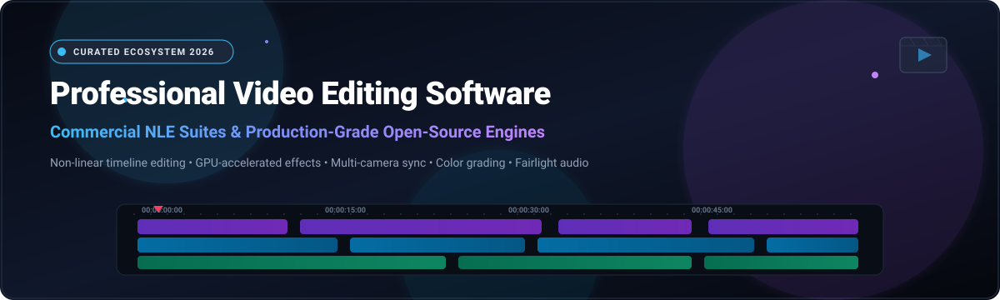
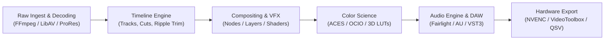

<p align="center">
  
</p>

# 🎬 Awesome Professional Video Editing Software

<p align="center">
  <a href="https://github.com/ishandutta2007/Awesome-Awesome-Awesome"></a>
  <a href="https://discord.gg/jc4xtF58Ve"></a>
  <a href="https://github.com/ishandutta2007/Awesome-Professional-Video-Editing-Software/stargazers"></a>
  <a href="https://github.com/ishandutta2007/Awesome-Professional-Video-Editing-Software/network/members"></a>
  <a href="https://github.com/ishandutta2007/Awesome-Professional-Video-Editing-Software/issues"></a>
  <a href="https://github.com/ishandutta2007/Awesome-Professional-Video-Editing-Software/blob/main/LICENSE"></a>
  <a href="https://github.com/ishandutta2007/Awesome-Professional-Video-Editing-Software/pulls"></a>
  <a href="https://github.com/ishandutta2007"></a>
</p>

---

A comprehensive, curated directory of **industry-standard commercial Non-Linear Editors (NLEs)**, **cutting-edge SaaS post-production suites**, and **high-performance open-source video editing engines**. Whether you require Hollywood-grade color grading, multi-camera live broadcast switching, programmatic React-based rendering, or privacy-preserving local AI tracking, this guide compares every tier with verified pricing, trial conditions, hardware requirements, and GitHub metrics.

---

## 📑 Table of Contents

- [🌐 Sector Overview & Market Dynamics](#-sector-overview--market-dynamics)
- [💼 Commercial & SaaS NLE Platforms](#-commercial--saas-nle-platforms)
- [💻 Open-Source Video Editing & Compositing Repositories](#-open-source-video-editing--compositing-repositories)
- [🔍 Architectural Deep-Dive: NLE Pipeline Components](#-architectural-deep-dive-nle-pipeline-components)
- [❓ Frequently Asked Questions (FAQ)](#-frequently-asked-questions-faq)
- [🤝 How to Contribute](#-how-to-contribute)
- [📈 Star History](#-star-history)
- [💖 Support & Community](#-support--community)
- [📜 License & Disclaimer](#-license--disclaimer)

---

## 🌐 Sector Overview & Market Dynamics

The global video editing software sector is valued at **$3.62 billion in 2024** and is projected to expand to **$6.48 billion by 2032**, registering a compound annual growth rate (**CAGR**) of **7.5%**. This rapid acceleration is propelled by the explosive growth of the creator economy, enterprise short-form video marketing, 4K/8K HDR streaming workflows, and the integration of on-device neural processing engines (neural masking, optical-flow retiming, and generative scene fill).

From a structural perspective, the market exhibits **moderate-to-high concentration at the high-end studio and broadcast tier**, where an established oligopoly—comprising **Apple, Adobe, Blackmagic Design, and Avid Technology**—commands deep proprietary ecosystem lock-in through dedicated hardware accelerators, studio color grading consoles, and collaborative SAN/NAS storage infrastructure. Conversely, the market experiences **increasing fragmentation in the indie, developer, and creator tiers**, where lightweight cross-platform suites and open-source engines (such as **Remotion, FFmpeg, LosslessCut, Kdenlive, and Shotcut**) empower solo creators and engineering teams to bypass recurring subscription taxes with open interchange standards and local-first workflows.

---

## 💼 Commercial & SaaS NLE Platforms

The table below catalogs premier commercial post-production suites and hosted SaaS solutions. The table is sorted **descending by Company Size** (measured by parent company market capitalization, enterprise valuation, or annual revenue).

| 🏢 Product / Company | 💰 Company Size (Valuation / Revenue) | 🏷️ Starting Pricing | ⏱️ Free Tier / Trial Limits | 🎯 Primary Focus & Strengths |
| :--- | :--- | :--- | :--- | :--- |
| [**Apple Final Cut Pro**](https://www.apple.com/final-cut-pro/) <br><sub>Apple Inc.</sub> | **~$3.50 Trillion** Market Cap <br>*(~$391.0B Annual Revenue)* | **$299.99** one-time perpetual license (macOS) or **$4.99/mo** / **$49.00/yr** (iPadOS) | **90-day fully functional free trial** on macOS (100% unrestricted exports, zero watermark, full ProRes/4K HDR support); **1-month free trial** on iPadOS. | Magnetic timeline 2, blazing Apple Silicon Metal optimization, object tracking, and native ProRes RAW performance. |
| [**Adobe Premiere Pro**](https://www.adobe.com/products/premiere.html) <br><sub>Adobe Inc.</sub> | **~$180.0 Billion** Market Cap <br>*(~$21.5B Annual Revenue)* | **$22.99/mo** (annual plan, paid monthly) or **$34.49/mo** (month-to-month plan) | **7-day unrestricted free trial**; includes 100GB Creative Cloud storage, Adobe Sensei AI tools, speech-to-text auto-captions, and Team Projects collaboration. | Industry standard NLE for broadcast and marketing agencies; deep ecosystem integration with After Effects, Photoshop, and Audition. |
| [**Avid Media Composer**](https://www.avid.com/media-composer) <br><sub>Avid Technology / STG</sub> | **~$1.40 Billion** Valuation <br>*(~$410.0M Annual Revenue)* | **$23.99/mo** ($239.00/yr billed annually) or **$34.99/mo** (month-to-month); Ultimate tier at **$49.99/mo** | **30-day fully functional trial** of Media Composer Ultimate; unlocks collaborative Avid NEXIS storage support, PhraseFind AI, and ScriptSync without export watermarks. | Gold standard for Hollywood feature films, multi-editor broadcast newsrooms, and large-scale shared editorial storage networks. |
| [**Wondershare Filmora**](https://filmora.wondershare.com/) <br><sub>Wondershare Technology</sub> | **~$1.30 Billion** Market Cap <br>*(~$210.0M Annual Revenue)* | **$49.99/yr** (Annual Subscription) or **$79.99** one-time perpetual license | **Free-forever plan available**; allows access to standard editing tools, but all exports feature a persistent, prominent center-screen Filmora watermark and 1GB cloud limit. | Accessible, drag-and-drop consumer NLE packed with instant AI smart cutouts, motion graphics templates, speed ramping, and auto-reframe. |
| [**Blackmagic DaVinci Resolve Studio**](https://www.blackmagicdesign.com/products/davinciresolve) <br><sub>Blackmagic Design Pty Ltd</sub> | **~$800.0 Million** Private Valuation <br>*(~$800.0M Annual Revenue)* | **$0.00** (Free base edition) or **$295.00** one-time perpetual license (Studio edition) | **Free-forever base tier**; full multi-track NLE, Fairlight audio, and Fusion VFX with **no watermark**, capped at 3840×2160 UHD @ 60fps, single GPU processing, and no Neural AI tools. | Industry-defining color grading grading wheels, node-based compositing, integrated Fairlight digital audio workstation, and remote collaboration. |
| [**CyberLink PowerDirector 365**](https://www.cyberlink.com/products/powerdirector-video-editing-software/) <br><sub>CyberLink Corp</sub> | **~$160.0 Million** Market Cap <br>*(~$55.0M Annual Revenue)* | **$4.33/mo** ($51.99/yr billed annually) or **$19.99/mo** (month-to-month subscription) | **30-day free trial**; PowerDirector Essential free edition embeds watermarks on renders, restricts 4K UHD output, and limits stock library downloads to 10 assets. | Fast rendering engine with hardware acceleration, multi-cam switching (up to 64 angles), AI body effects, and built-in screen recording. |
| [**MAGIX VEGAS Pro**](https://www.vegascreativesoftware.com/us/vegas-pro/) <br><sub>MAGIX Software GmbH</sub> | **~$60.0 Million** Private Valuation <br>*(~$60.0M Annual Revenue)* | **$19.99/mo** ($239.88/yr billed annually) or **$199.00** one-time perpetual license (VEGAS Pro Edit) | **30-day free trial**; provides access to all timeline editing tools, nested timelines, and Mocha VEGAS planar tracking, but caps final output render duration to 2 minutes. | Flexible non-modal timeline editing, high-precision audio editing inherited from Sound Forge, and customizable hardware-accelerated previewing. |
| [**LWKS Lightworks Pro**](https://lwks.com/) <br><sub>LWKS Software Ltd</sub> | **~$10.0 Million** Private Valuation <br>*(~$8.0M Annual Revenue)* | **$9.99/user/mo** ($99.99/yr) for Create or **$23.99/user/mo** ($239.99/yr) for Pro | **Free-forever plan available**; offers unlimited tracks and multi-camera editing, but export format is strictly limited to 720p (1280×720) direct uploads to YouTube/Vimeo only. | Heritage film editing engine (used on *The Wolf of Wall Street* and *Pulp Fiction*) featuring lightning-fast drag-and-drop trim scrubbing and console control. |

---

## 💻 Open-Source Video Editing & Compositing Repositories

The repositories below represent leading production-grade, open-source video editing suites, CLI transcoding engines, programmatic video libraries, and specialized compositors. Repositories are sorted in **descending order of GitHub Star count**.

---

### 1. ⚛️ Remotion — Programmatic Video Creation in React
[](https://github.com/remotion-dev/remotion/stargazers)  
- **Repository**: [remotion-dev/remotion](https://github.com/remotion-dev/remotion)  
- **License**: Custom Open-Source (Free for individuals and companies up to 3 employees)  
- **Supported Platforms**: Cross-Platform (Node.js, Chromium, AWS Lambda, Docker)  
- **Core Strengths**: Allows developers to write real videos programmatically using standard React components, CSS animations, SVG canvases, and web APIs. Features frame-accurate rendering, dynamic personalized video generation at scale, and serverless distributed rendering on AWS Lambda.  
- **Best For**: Engineering teams building automated video generation pipelines, personalized marketing video engines, and SaaS apps requiring dynamic video synthesis.

---

### 2. ⚡ FFmpeg — The Universal Multimedia Engine & Transcoder
[](https://github.com/FFmpeg/FFmpeg/stargazers)  
- **Repository**: [FFmpeg/FFmpeg](https://github.com/FFmpeg/FFmpeg)  
- **License**: LGPL v2.1+ / GPL v2+  
- **Supported Platforms**: Linux, macOS, Windows, BSD, Android  
- **Core Strengths**: The foundation underpinning nearly every modern video editor on earth. Delivers unmatched codec support (H.264, HEVC, AV1, ProRes, DNxHR, VP9), multi-stream muxing/demuxing, hardware acceleration via NVENC, QuickSync, VA-API, and Apple VideoToolbox, and hundreds of complex filtering graphs.  
- **Best For**: Backend media pipelines, headless cloud transcoding, automated batch concatenation, and custom filterchain processing.

---

### 3. ✂️ LosslessCut — Ultra-Fast Stream-Copy Video Trimmer
[](https://github.com/mifi/lossless-cut/stargazers)  
- **Repository**: [mifi/lossless-cut](https://github.com/mifi/lossless-cut)  
- **License**: GPL v2.0  
- **Supported Platforms**: macOS, Windows, Linux  
- **Core Strengths**: Performs near-instantaneous slicing, cutting, joining, and track reordering of massive 4K/8K camera files without decoding or re-encoding. Operates directly on keyframe stream copies, preserving 100% original camera sensor quality with zero generation loss and near-zero CPU/GPU heat.  
- **Best For**: Cinematographers, drone operators, and action-cam editors quickly pruning multi-gigabyte raw footage before importing into primary NLE timelines.

---

### 4. 🧊 Blender (Video Sequence Editor - VSE) — Integrated 3D & Timeline NLE
[](https://github.com/blender/blender/stargazers)  
- **Repository**: [blender/blender](https://github.com/blender/blender)  
- **License**: GPL v2.0+  
- **Supported Platforms**: Windows, macOS, Linux  
- **Core Strengths**: A fully capable non-linear multi-track video editing system embedded inside the acclaimed Blender 3D production suite. Supports channel-based multi-track editing, color grading via OpenColorIO (OCIO), sound scrubbing, and seamless integration with Blender’s 3D viewport, Grease Pencil, and compositing nodes.  
- **Best For**: 3D animators, game developers, and VFX artists wishing to composite, cut, and finalize cinematics without switching applications.

---

### 5. 🎞️ Shotcut — Format-Flexible Cross-Platform NLE
[](https://github.com/mltframework/shotcut/stargazers)  
- **Repository**: [mltframework/shotcut](https://github.com/mltframework/shotcut)  
- **License**: GPL v3.0  
- **Supported Platforms**: Windows, macOS, Linux  
- **Core Strengths**: Powered by the robust MLT Media Lovin' Toolkit and FFmpeg. Handles hundreds of exotic codecs natively without intermediate transcoding. Offers 4K resolution timelines, 3-way color grading wheels, keyframe-driven filter automation, professional audio scopes (Peak, Waveform, Spectrogram), and multi-format timeline mixing.  
- **Best For**: Solo creators, educators, and cross-platform video editors wanting a dependable, zero-subscription desktop editor that handles unusual camera formats with ease.

---

### 6. 🐍 MoviePy — Script-Driven Video Editing with Python
[](https://github.com/Zulko/moviepy/stargazers)  
- **Repository**: [Zulko/moviepy](https://github.com/Zulko/moviepy)  
- **License**: MIT License  
- **Supported Platforms**: Cross-Platform (Python 3.8+)  
- **Core Strengths**: Enables programmatic video editing via expressive Python scripts. Supports non-linear cuts, concatenated montages, title and watermark overlay generation, audio mixing, and integration with NumPy and SciPy for mathematical pixel transformations.  
- **Best For**: Data scientists, generative AI researchers, and automation engineers programmatically generating algorithmic social media videos, GIF previews, and animated plots.

---

### 7. 🎯 Gyroflow — Video Stabilization via IMU/Gyroscope Telemetry
[](https://github.com/gyroflow/gyroflow/stargazers)  
- **Repository**: [gyroflow/gyroflow](https://github.com/gyroflow/gyroflow)  
- **License**: GPL v3.0  
- **Supported Platforms**: Windows, macOS, Linux, iOS, Android  
- **Core Strengths**: Revolutionary open-source post-processing stabilization software that computes camera motion from internal sensor gyro telemetry (GoPro, Sony, RED, Blackmagic, Insta360, Betaflight) rather than optical pixel guessing. Produces cinema-smooth footage without optical warping artifacts. Includes plugins for DaVinci Resolve, Premiere Pro, and Final Cut Pro.  
- **Best For**: FPV drone pilots, action videographers, and independent filmmakers seeking gimbal-like smoothness without the physical gimbal weight.

---

### 8. 🌿 Olive Video Editor — Node-Based Non-Linear Compositing NLE
[](https://github.com/olive-editor/olive)  
- **Repository**: [olive-editor/olive](https://github.com/olive-editor/olive)  
- **License**: GPL v3.0  
- **Supported Platforms**: Windows, macOS, Linux  
- **Core Strengths**: Pioneers a fully customizable node-based rendering pipeline directly fused into a classic non-linear timeline. Users can wire together custom shaders, math operations, and keyframes visually. Built-in OpenColorIO (OCIO) color management enables end-to-end ACES workflows.  
- **Best For**: Technical editors, compositors, and colorists who feel restricted by standard layer stacks and require node-level data manipulation inside their NLE.

---

### 9. 🎨 OpenShot Video Editor — Friendly Drag-and-Drop Creator Suite
[](https://github.com/OpenShot/openshot-qt)  
- **Repository**: [OpenShot/openshot-qt](https://github.com/OpenShot/openshot-qt)  
- **License**: GPL v3.0  
- **Supported Platforms**: Windows, macOS, Linux, ChromeOS  
- **Core Strengths**: Exceptional beginner accessibility with an intuitive drag-and-drop timeline. Provides unlimited audio/video tracks, curve-based keyframe animations, audio waveforms, 3D animated titles powered by Blender, and slow-motion/speed curve adjustments.  
- **Best For**: Beginners, students, educators, and casual video creators who need quick cuts, voiceover narration, and title cards without a steep learning curve.

---

### 10. 🐧 Kdenlive — Professional KDE Multi-Track NLE with Local AI
[](https://github.com/KDE/kdenlive)  
- **Repository**: [KDE/kdenlive](https://github.com/KDE/kdenlive)  
- **License**: GPL v3.0  
- **Supported Platforms**: Linux, Windows, macOS, FreeBSD  
- **Core Strengths**: The flagship open-source Premiere Pro alternative backed by the KDE community. Features a multi-track nested sequence timeline, proxy editing, customizable hotkey layouts, and integrated open-source AI: **SAM2 (Segment Anything 2) for local object tracking** and **VOSK/Whisper for on-device automatic speech-to-text subtitling**. Transparent XML project architecture ensures zero proprietary file lock-in.  
- **Best For**: Professional Linux desktop editors, open-source advocates, and independent creators requiring a full-fledged Premiere-style workflow with zero subscription fees.

---

### 11. 🪄 Natron — Node-Based VFX & Digital Motion Compositor
[](https://github.com/NatronGitHub/Natron)  
- **Repository**: [NatronGitHub/Natron](https://github.com/NatronGitHub/Natron)  
- **License**: GPL v2.0  
- **Supported Platforms**: Windows, macOS, Linux  
- **Core Strengths**: Open-source node-based compositing software architecturally modeled after foundry industry standards like Nuke. Complies with the OpenFX standard, allowing integration of commercial and open-source VFX plugins. Features 32-bit floating-point linear color processing, planar tracking, and roto/keying suites.  
- **Best For**: Visual effects artists, rotoscoping specialists, and motion compositors seeking a free, node-based companion to non-linear editors.

---

### 12. 🏎️ Flowblade — Fast Precision-Cutting Editor for Linux
[](https://github.com/jliljebl/flowblade)  
- **Repository**: [jliljebl/flowblade](https://github.com/jliljebl/flowblade)  
- **License**: GPL v3.0  
- **Supported Platforms**: Linux  
- **Core Strengths**: Engineered specifically for speed and razor-sharp timeline accuracy. Incorporates dedicated Insert and Top-Down editing models inspired by professional tape and Avid paradigms. Backed by MLT and FFmpeg with built-in G'MIC image processing filters and GPU-accelerated rendering.  
- **Best For**: Dedicated Linux users editing documentary, interview, and narrative projects where ripple cutting and magnetic trim speeds are prioritized.

---

### 13. 🔄 OpenTimelineIO — Editorial Timeline Interchange Format & API
[](https://github.com/AcademySoftwareFoundation/OpenTimelineIO)  
- **Repository**: [AcademySoftwareFoundation/OpenTimelineIO](https://github.com/AcademySoftwareFoundation/OpenTimelineIO)  
- **License**: Apache 2.0  
- **Supported Platforms**: Cross-Platform (Python, C++, Rust bindings)  
- **Core Strengths**: Managed under the Academy Software Foundation (ASWF). Formats and parses editorial cuts, transitions, audio tracks, and clip markers into an agnostic schema. Bridges editorial timelines between Final Cut Pro XML, AAF, CMX 3600 EDL, Premiere Pro, and DaVinci Resolve.  
- **Best For**: Pipeline technical directors (TDs) and developers constructing automated conform, editorial turnover, and VFX shot ingestion workflows.

---

### 14. 🪟 Pitivi — GNOME-Native GStreamer Video Editor
[](https://github.com/pitivi/pitivi)  
- **Repository**: [pitivi/pitivi](https://github.com/pitivi/pitivi)  
- **License**: LGPL v2.1+  
- **Supported Platforms**: Linux (Flathub)  
- **Core Strengths**: Integrates smoothly into the GNOME desktop human interface guidelines. Powered by the GStreamer Editing Services (GES) framework, featuring automatic audio/video synchronization, non-modal trimming, and clean timeline curves.  
- **Best For**: Linux users seeking a native GTK/GNOME desktop video editor for straightforward narrative assembly and family archiving.

---

### 15. 📽️ Cinelerra CV — High-Throughput Linux Studio Editor & Compositor
[](https://github.com/cinelerra-cv-team/cinelerra-cv)  
- **Repository**: [cinelerra-cv-team/cinelerra-cv](https://github.com/cinelerra-cv-team/cinelerra-cv)  
- **License**: GPL v2.0  
- **Supported Platforms**: Linux (Native)  
- **Core Strengths**: One of the earliest broadcast-capable non-linear video editors for Linux. Features native support for 8K video, 400+ codecs via FFmpeg, multi-monitor editing console integration, sub-pixel motion tracking, and network distributed rendering over local clusters.  
- **Best For**: High-end Linux workstations handling broadcast capture, legacy tape ingestion, and multi-node cluster rendering.

---

## 🔍 Architectural Deep-Dive: NLE Pipeline Components

Modern professional video post-production suites consist of 5 core architectural subsystems:



1. **Ingest & Demuxing Layer**: Decodes raw camera container formats (BRAW, REDCODE, ProRes RAW, Sony XAVC) into uncompressed frame buffers using either hardware ASICs (Apple Media Engine, Nvidia NVDEC) or software libraries (FFmpeg).
2. **Timeline Sequencing Core**: Coordinates frame-accurate timecodes (SMPTE standard: 23.976, 24, 25, 29.97, 30, 59.94, 60, 120 fps). Manages ripple edits, roll trims, slip/slide tools, and multi-camera angle synchronization.
3. **Compositing & Effects**: Processes visual layers through either stacked track hierarchies (Premiere, Final Cut Pro) or directed acyclic graphs / node systems (DaVinci Fusion, Natron, Olive).
4. **Color Management Science**: Converts camera log gammas (LogC, S-Log3, Canon Log, V-Log) into standardized display color spaces (Rec.709, DCI-P3, Rec.2020 HDR) using OpenColorIO (OCIO) or ACES (Academy Color Encoding System).
5. **Mastering & Hardware Export**: Multiplexes mastered multichannel audio (Fairlight, Audition) with GPU-accelerated H.264/HEVC/AV1 encoding engines for broadcast delivery or web streaming.

---

## ❓ Frequently Asked Questions (FAQ)

### What is the best free open-source alternative to Adobe Premiere Pro?
**Kdenlive** and **Shotcut** are the two closest open-source drop-in replacements for Adobe Premiere Pro. Kdenlive provides a familiar multi-track layout, nested timelines, Premiere hotkey presets, and local AI capabilities (SAM2 object tracking, offline speech-to-text subtitling). Shotcut offers superior format flexibility with zero setup friction and 4K HDR color wheels.

### Is Blackmagic DaVinci Resolve truly free without a watermark?
Yes! The standard edition of **DaVinci Resolve is 100% free with no export watermark** and no time expiration. It supports complete multi-track video editing, Fairlight digital audio mixing, and Fusion node compositing up to 4K UHD (3840×2160) at 60 fps. The paid **Studio edition ($295)** adds the DaVinci Neural Engine AI tools (magic mask, face refinement, voice isolation), multi-GPU acceleration, stereoscopic 3D, and resolutions beyond 4K.

### Which video editing software is best for Linux workstations?
For dedicated Linux systems, **Kdenlive** (KDE/Qt) and **DaVinci Resolve** (CentOS/Rocky Linux native) represent the two premier professional options. For rapid lightweight cutting, **LosslessCut** and **Flowblade** excel on Linux distributions.

### How does Remotion differ from traditional NLEs like Final Cut Pro or Premiere?
Traditional NLEs utilize graphical mouse-driven timelines to arrange pre-recorded video clips. **Remotion is a code-first programmatic video framework** that allows developers to write React/TypeScript code to render video frames. It is designed for generating programmatic video at scale (e.g., personalized onboarding videos, programmatic social media snippets, data visualization animations) via automated cloud rendering clusters.

---

## 🤝 How to Contribute

Contributions from video editors, colorists, sound designers, and developers are warmly welcomed!

1. 🍴 **Fork the Repository** on GitHub.
2. 🌿 **Create a Feature Branch**:
   ```bash
   git checkout -b feature/add-new-nle-suite
   ```
3. 📝 **Add or Update Entries**: Maintain factual precision, verified starting pricing, explicit free tier limits, and valid repository links.
4. 🧪 **Validate Formatting**: Ensure markdown tables render cleanly and all badges resolve correctly.
5. 🚀 **Submit a Pull Request**: Include a concise description of the software added or corrected.

---

## 📈 Star History

[](https://star-history.dera.page/#ishandutta2007/Awesome-Professional-Video-Editing-Software&type=date&legend=top-left)

---

## 💖 Support & Community

Thank you for exploring and supporting the **Awesome Professional Video Editing Software** ecosystem! If this curated guide helped you discover your ideal editing suite, optimize your post-production workflow, or build custom automated video infrastructure, please consider supporting the project:

- ⭐ **Star this repository** to help other editors and creators discover it on GitHub.
- 🍴 **Fork and contribute** updates, hardware benchmarks, and newly launched open-source editors.
- 📢 **Share with fellow creatives**, colorists, video editors, and audio engineers.
- ☕ **Support maintenance and curation** directly on the [GitHub Sponsor Dashboard](https://github.com/sponsors/ishandutta2007).

---

## 📜 License & Disclaimer

- **License**: Released under the [MIT License](LICENSE).
- **Disclaimer**: All product names, logos, and brands are property of their respective owners. Company valuations and market capitalizations reflect publicly available financial data and market estimates. Software pricing and free-tier limitations are subject to change by their respective vendors.

---

<p align="center">
  <b>Crafted with ❤️ for video editors, VFX compositors, and multimedia creators worldwide.</b><br>
  <sub>Let's build a more accessible, open, and high-performance post-production landscape.</sub>
</p>
